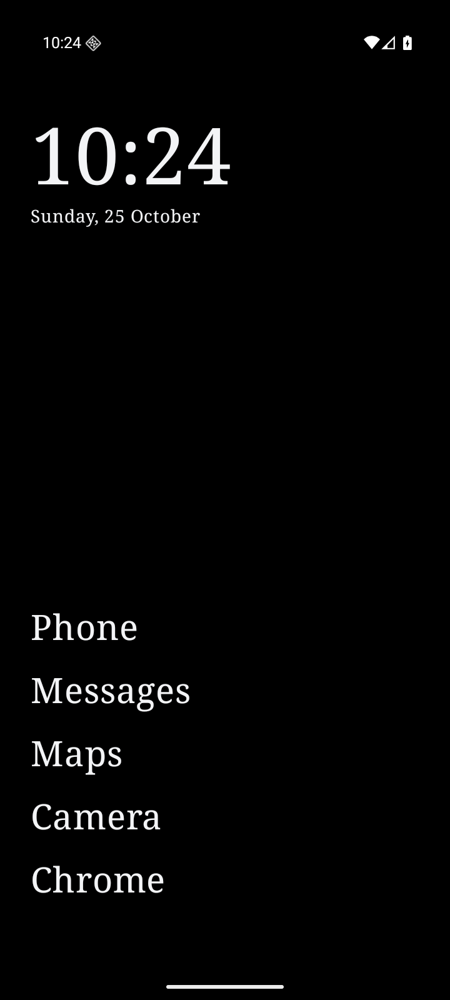
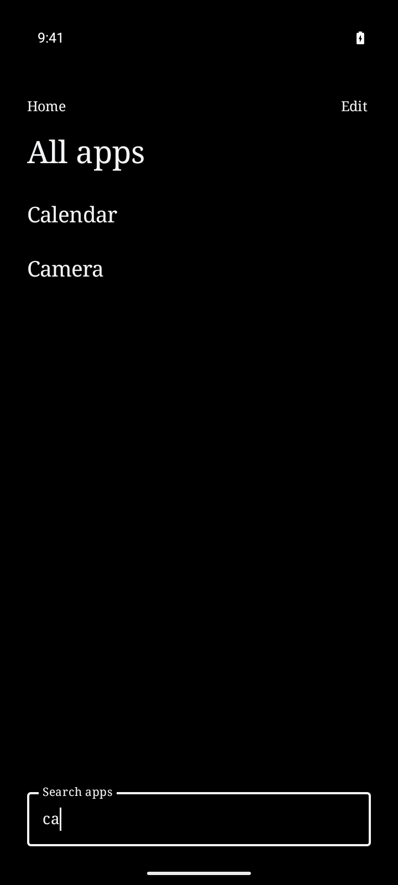
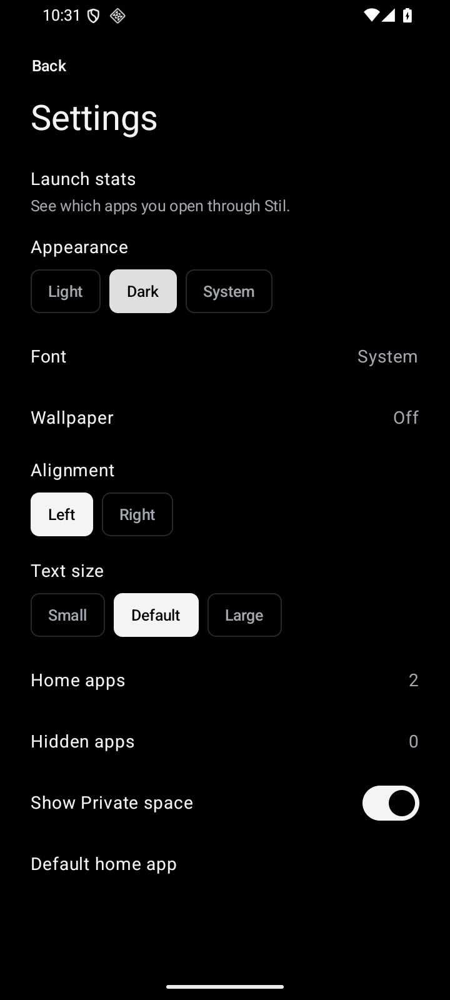
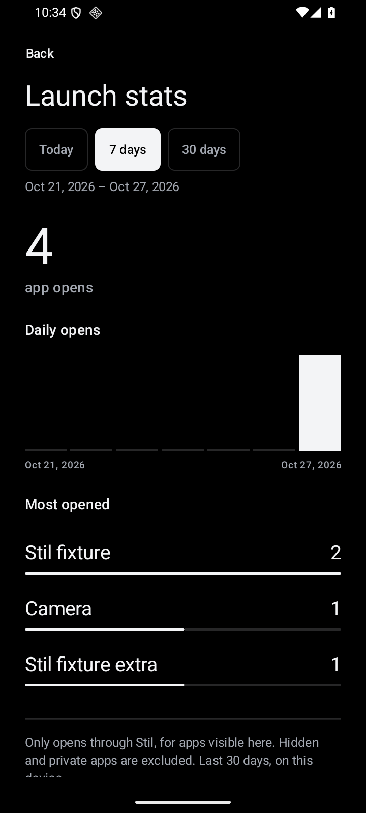
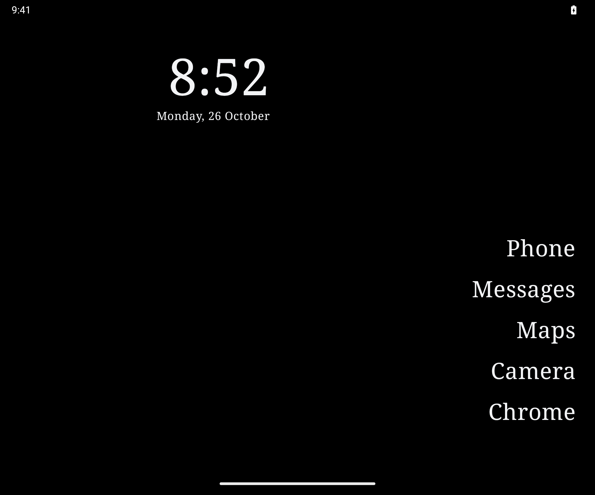
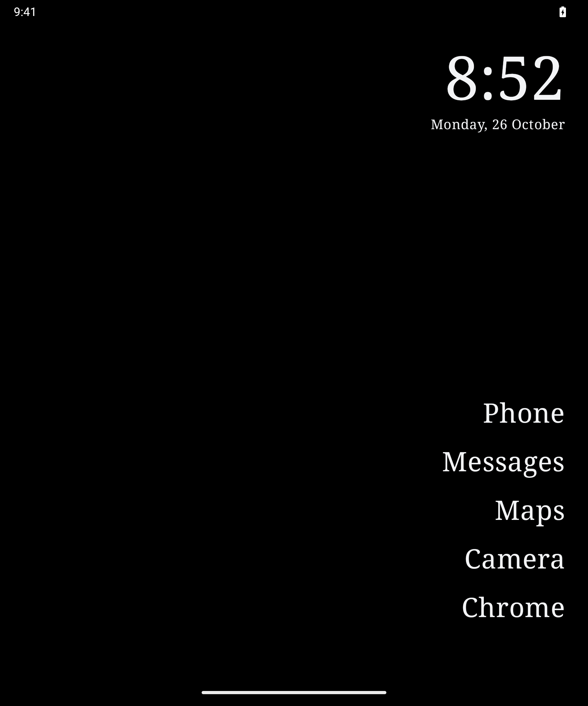

# Stil

A minimal Android launcher with a short app list, custom fonts, and daily wallpapers.

**Preview.** Android 8.0 or later. Repository access is required while Stil is private. [Download Stil 0.4.0](https://github.com/tiaanduplessis/stil/releases/tag/v0.4.0).

[Build and try Stil](#try-stil) · [User guide](docs/usage.md)

<p>
  
  
  
  
</p>

## See it in use

https://github.com/user-attachments/assets/48e13ffa-54a2-4293-bafd-1ffc1d12d761

[Download the walkthrough (MP4)](docs/media/walkthrough.mp4) · [Text walkthrough](docs/usage.md#walkthrough)

These are captures of the Android app, not the HTML prototype. [Media notes and photo credits](docs/media/README.md).

In 0.4.0, All apps slides up and opens the sole search match as you type. [Watch the search flow (MP4)](docs/media/app-search.mp4).

## Try Stil

Download the signed [0.4.0 APK](https://github.com/tiaanduplessis/stil/releases/download/v0.4.0/stil-0.4.0.apk) and install it on your phone. Android may ask you to allow installation from your browser or file manager. Open Stil, choose your home apps, then select **Use Stil** in Android's default-home picker.

Development APKs are available from successful [CI runs](https://github.com/tiaanduplessis/stil/actions/workflows/ci.yml) as `stil-debug` artifacts. Those downloads expire after seven days.

Or build from source:

1. Install JDK 17 and Android SDK 36. Set `ANDROID_HOME`, or add `sdk.dir=/absolute/path/to/sdk` to an untracked `local.properties` file.
2. Clone the repository and build:

   ```sh
   git clone https://github.com/tiaanduplessis/stil.git
   cd stil
   ./gradlew :app:assembleDebug --max-workers=1 --no-parallel
   ```

3. Install `app/build/outputs/apk/debug/app-debug.apk` on your phone. Android may ask you to allow installation from the browser or file manager you used.
4. Open Stil, choose one to six home apps, then select **Use Stil** in Android's default-home picker.

Remove a debug install before installing the signed preview; their signing identities differ, and uninstalling removes settings. Debug builds from different runners may also require a fresh install. To switch launchers later, use **Settings → Default home app**. More setup and recovery steps are in the [user guide](docs/usage.md).

## What it does

- **A short home screen.** Swipe up for apps; hold empty space for settings. Pin up to six apps, rename and reorder them, or hide apps and restore them later. Search finds original names and aliases.
- **Your type and background.** Choose System, Sans, Serif, or Mono; Light, Dark, or System appearance; alignment and text size. Use daily photos, keep one, or turn wallpaper off.
- **A deliberate pause.** Selected apps can wait three seconds before an explicit **Open**. **Cancel** returns immediately.
- **Local launch stats.** Settings shows opens by app for Today, 7 days, or 30 days, with daily activity. Private space is never recorded; hidden apps stay out of the views. This feature is in the current source and is not yet in the signed 0.4.0 preview.
- **Separate profiles.** Work apps have profile controls. On supported devices, Private space has its own lockable container and search. Private apps stay out of global search and home pins.
- **Fold and flip layouts.** Home adapts to narrow, wide, and tabletop windows, with hinge clearance and continuous editing.
- **Quiet motion.** Short transitions respond to navigation and selection. Android's animation settings control them.

Private space requires Android 15 or later and selection as the default home app. Profile availability and system gestures vary by device. Runtime verification currently uses an Android 16 emulator; physical devices have not yet been tested.

## Fold and flip devices

Home adjusts when you open, close, or partly fold the device.

<p>
  
  
</p>

## Privacy

No account, ads, telemetry, usage access, accessibility service, or notification access. Core launcher features work offline. Optional photo downloads use Lorem Picsum and retain photographer/source attribution. Failed downloads keep the current photo; Android may delay background updates.

Preferences, launch counts, and cached photos stay on the device. Read the [privacy notes](docs/privacy.md) for network requests, permissions, and wallpaper behavior. Bundled photo credits are in [third-party notices](THIRD_PARTY_NOTICES.md).

## Build, contribute, and get help

- [Build and test](CONTRIBUTING.md#build-and-test)
- [Report a bug or suggest a change](https://github.com/tiaanduplessis/stil/issues/new/choose)
- [Usage and troubleshooting](docs/usage.md)
- [Report a security issue privately](SECURITY.md)
- [Architecture and motion](docs/development.md)
- [Release preparation](docs/releasing.md)

[GitHub Actions](https://github.com/tiaanduplessis/stil/actions) runs on app, build, tooling, or workflow changes pushed to `main`. It builds debug and minified release APKs, runs unit tests and lint, and tests on an Android 16 emulator. Manual release checks also cover Android 8.0. [Release setup](docs/releasing.md) covers signing and manual draft releases.

Kotlin, Jetpack Compose, DataStore, and WorkManager power the native app. The [HTML prototype](mockups/index.html), [research](docs/research.md), and [design notes](docs/design.md) remain development references. The Android app does not use a WebView, and no source was copied from Olauncher.

## License

Stil's source code is licensed under [MIT](LICENSE). Third-party photos and libraries retain their own terms; see [third-party notices](THIRD_PARTY_NOTICES.md).
